# Панель управления гребного тренажёра Dante (дисплейный модуль DC2)

## Руководство пользователя

Версия документа: 1.0 (22.10.2026)
Версия прошивки, по которой составлено руководство: 0.6.10

---

## Содержание

1. [О руководстве](#1-о-руководстве)
2. [Общие сведения о панели](#2-общие-сведения-о-панели)
3. [Включение и главный экран](#3-включение-и-главный-экран)
4. [Общие элементы интерфейса](#4-общие-элементы-интерфейса)
5. [Как начать тренировку: три способа](#5-как-начать-тренировку-три-способа)
6. [Быстрая тренировка](#6-быстрая-тренировка)
7. [Экран тренировки](#7-экран-тренировки)
8. [Тренировка с программой](#8-тренировка-с-программой)
9. [Заезд (соревновательный режим)](#9-заезд-соревновательный-режим)
10. [История тренировок](#10-история-тренировок)
11. [Спортсмен](#11-спортсмен)
12. [Подключения: Wi‑Fi и пульсометр](#12-подключения-wifi-и-пульсометр)
13. [Опции и настройки](#13-опции-и-настройки)
14. [Обновление прошивки](#14-обновление-прошивки)
15. [Возможные проблемы и их решение](#15-возможные-проблемы-и-их-решение)
16. [Уход, питание и безопасность](#16-уход-питание-и-безопасность)
17. [Приложения](#17-приложения)

---

## 1. О руководстве

Это руководство описывает работу с сенсорной панелью управления (дисплейным модулем DC2), установленной на гребном тренажёре Dante. Панель измеряет параметры гребли, ведёт тренировки по заданным целям, хранит историю, обеспечивает подключение к пульсометру, сети Wi‑Fi и программе организации заездов.

Внешний вид экранов на иллюстрациях снят с реального устройства.

Условные обозначения:

| Обозначение | Значение |
|---|---|
| **МЕНЮ**, **ИЗМЕНИТЬ** | Названия кнопок и пунктов меню на экране |
| → | Последовательность переходов: **Главное меню → Подключения → Wi‑Fi** |
| ▲ ▼ | Стрелки-регуляторы значения на экране |
| ⚠ | Важное предупреждение |
| ℹ | Полезное замечание |

К руководству прилагаются:

- **Быстрый старт** (`Быстрый_старт.html` / `Быстрый_старт.pdf`) — памятка на одну страницу.
- **Интерактивная справка** (`Интерактивная_справка.html`) — «живой» макет панели: щёлкайте по элементам экрана, чтобы переходить между окнами и читать описание каждой зоны.

---

## 2. Общие сведения о панели

### 2.1 Назначение

Панель управления выполняет:

- проведение тренировок по целям: дистанция, время, количество гребков, с интервалами и отдыхом;
- сравнение формы кривой мощности гребка с эталонными кривыми;
- ведение истории тренировок с разбивкой по интервалам;
- приём пульса с Bluetooth-пульсометра;
- участие в групповых заездах под управлением внешней программы (по Wi‑Fi или по проводной шине CAN);
- автоматическое обновление прошивки через интернет;
- вычисление параметров движения лодки.

### 2.2 Состав

| Компонент | Описание |
|---|---|
| Дисплей | Цветной сенсорный 7" экран в вертикальной ориентации |
| Питание | Встроенный аккумулятор, заряд от внешнего адаптера (USB Type‑C). Переключатель питания на корпусе |
| Связь | Wi‑Fi, Bluetooth (пульсометры), кабельное соединение для проводных заездов |
| Часы | Встроенные часы (ходят при выключенном питании) |

### 2.3 Карта экранов

```
Загрузка (логотип)
└── ГЛАВНОЕ МЕНЮ
    ├── Быстрая тренировка ──┬── Окно «Цель / Сплит / Лидер» (для режима «Одиночная со сплитами»)
    │                        └── ЭКРАН ТРЕНИРОВКИ ── Отдых ── Финиш ── окно «Выйти из тренировки?»
    ├── Тренировка с программой (Создать программу) ── ЭКРАН ТРЕНИРОВКИ
    ├── Заезд (номер группы, дорожки, режим CAN) ── Подготовка к заезду ── Заезд ── Остановка
    ├── История тренировок ── Информация о тренировке (интервалы)
    ├── Спортсмен (6 профилей)
    ├── Подключения ──┬── Wi‑Fi: список сетей ── ввод пароля ── состояние подключения
    │                 └── Пульсометр: список устройств
    └── Опции и настройки ──┬── Установка времени
                            └── Обновление прошивки (подробно)
```

ℹ Грести можно прямо из главного меню: после первых гребков панель сама откроет экран тренировки (см. раздел 5).

---

## 3. Включение и главный экран

1. Включите питание переключателем на корпусе панели.
2. На экране появится логотип загрузки (около секунды), затем откроется главное меню.

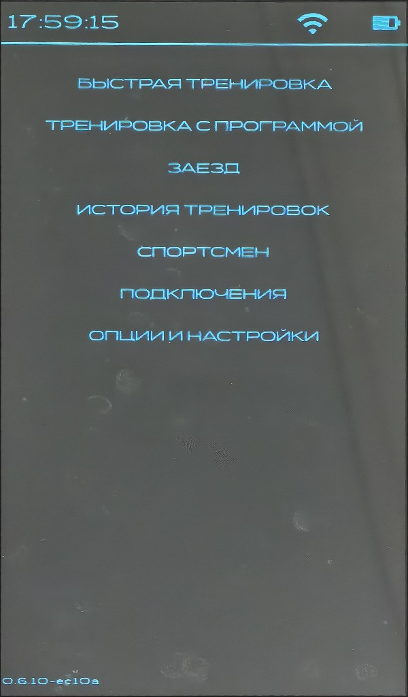

### 3.1 Строка состояния

Строка состояния одинакова на всех экранах.

| Элемент | Значение |
|---|---|
| Время (слева) | Текущее время встроенных часов. Если часы не установлены, в настройках будет написано «Не установлено!» — задайте время (раздел 13.2) |
| Значок Wi‑Fi | Отображается только при подключении к сети. **Синий** — панель подключена к Wi‑Fi. **Зелёный** — панель дополнительно связана с внешней управляющей программой (сервером заездов) |
| Значок Bluetooth | Отображается, когда подключён пульсометр |
| Значок зарядки | Отображается, когда идёт заряд аккумулятора |
| Значок батареи | Уровень заряда в пяти градациях: полный, высокий (до 90 %), средний (до 70 %), низкий (до 30 %), критический (до 10 %) |

В левом нижнем углу главного меню мелким шрифтом выводится версия прошивки (например, `0.6.10‑ec10a`). Её спрашивает служба поддержки.

### 3.2 Пункты главного меню

| Пункт | Что открывает | Раздел |
|---|---|---|
| **БЫСТРАЯ ТРЕНИРОВКА** | Готовые цели: 1000, 2000, 5000, 10000 м, 30 минут, интервалы 500 м / 1 мин отдыха, одиночная со сплитами | 6 |
| **ТРЕНИРОВКА С ПРОГРАММОЙ** | Редактор многоинтервальных программ (до 99 сохранённых слотов) и их запуск | 8 |
| **ЗАЕЗД** | Настройка номера группы и дорожки для соревнований, включение проводного режима CAN | 9 |
| **ИСТОРИЯ ТРЕНИРОВОК** | Список выполненных тренировок и заездов с подробностями по интервалам | 10 |
| **СПОРТСМЕН** | Шесть профилей: пол, возраст, рост, вес | 11 |
| **ПОДКЛЮЧЕНИЯ** | Wi‑Fi и пульсометр | 12 |
| **ОПЦИИ И НАСТРОЙКИ** | Яркость, дата и время, обновление прошивки, общая статистика | 13 |

---

## 4. Общие элементы интерфейса

Ниже собраны элементы, которые повторяются на разных экранах панели. Все они срабатывают от короткого касания пальцем; удерживать не нужно.

### 4.1 Кнопки навигации

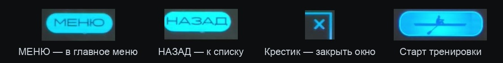

- **МЕНЮ** (внизу слева) — возврат в главное меню. Во время тренировки открывает окно подтверждения выхода.
- **НАЗАД** — на экране информации о тренировке возвращает в список истории.
- **✕** в правом верхнем углу всплывающего окна — закрыть окно без сохранения.
- **Кнопка с пиктограммой гребца** (внизу, синяя) — запуск тренировки с выбранными параметрами.

### 4.2 Кнопки действий

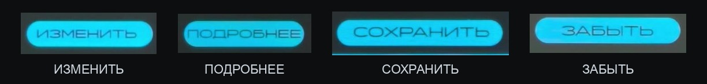

Голубые кнопки с надписью выполняют одно действие на текущем экране:

- **ИЗМЕНИТЬ** — открыть окно настройки (сплиты быстрой тренировки, дата и время).
- **ПОДРОБНЕЕ** — открыть подробности записи истории или страницу обновления прошивки.
- **СОХРАНИТЬ** — применить значения во всплывающем окне и закрыть его.
- **ЗАБЫТЬ** — удалить сохранённую Wi‑Fi‑сеть.

### 4.3 Поразрядные стрелки ▲ ▼

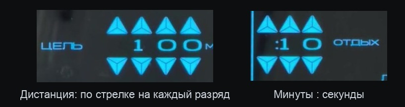

Числовые значения задаются отдельными стрелками над и под каждой цифрой. Стрелка ▲ увеличивает разряд на единицу (после 9 идёт 0), стрелка ▼ уменьшает. Пример: чтобы вместо 1000 м задать 100 м, нажмите ▼ над разрядом тысяч один раз. Значения ограничены допустимым диапазоном (например, дистанция 1…9999 м).

Для минут и секунд (время отдыха, темп лидера) стрелки меняют минуты и секунды раздельно.

### 4.4 Переключатель «ВРЕМЯ / ДИСТАНЦИЯ / ГРЕБКИ»

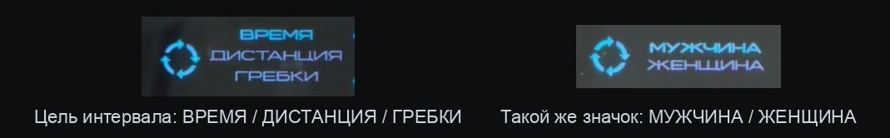

Круглый значок с двумя стрелками рядом с подписями **ВРЕМЯ**, **ДИСТАНЦИЯ**, **ГРЕБКИ** выбирает, чем ограничивается интервал. Каждое нажатие на значок переключает категорию по кругу, а подсвеченная подпись показывает текущий выбор. При смене категории значение сбрасывается на типовое: 30 мин, 1000 м или 100 гребков.

Тот же значок используется на экране «Спортсмен» для выбора пола.

### 4.5 Включаемые параметры (ЛИДЕР, ТЕМП)

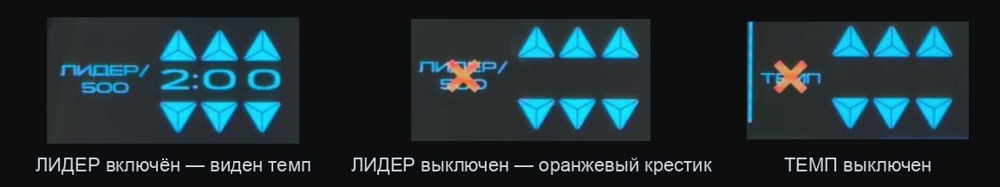

Подписи **ЛИДЕР/500** и **ТЕМП** работают как выключатели. Если параметр выключен, поверх подписи показан оранжевый крестик, а его значение скрыто. Нажмите на подпись, чтобы включить параметр; появятся цифры для его настройки.

### 4.6 Стрелки ◀ ▶

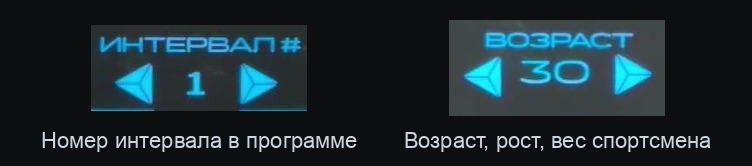

Стрелки по сторонам от числа перебирают значения по одному: номер интервала в программе, возраст, рост и вес спортсмена. Дойдя до границы диапазона, значение останавливается.

### 4.7 Ползунки

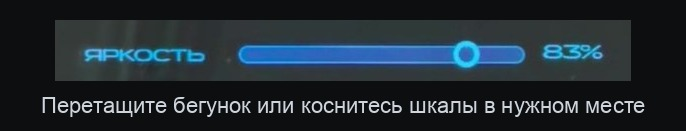

Яркость, снижение яркости и таймер подсветки задаются ползунками: перетащите бегунок или коснитесь шкалы в нужном месте. Текущее значение показано справа и сохраняется сразу.

### 4.8 Списки и страницы

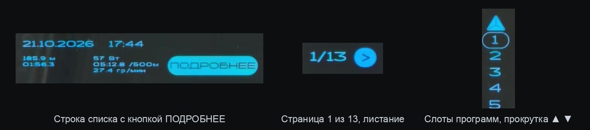

Длинные списки (история тренировок, интервалы, Wi‑Fi‑сети, слоты программ) разбиты на страницы. Внизу показан номер страницы вида `1/13`, рядом — стрелки **<** и **>** для листания. Список слотов программы прокручивается стрелками ▲ ▼ слева; выбранный слот обведён.

### 4.9 Подсветка

Через заданное время бездействия подсветка снижается до заданного процента (раздел 13.1). Любое касание экрана возвращает полную яркость.

---

## 5. Как начать тренировку: три способа

| Способ | Когда удобно | Что делать |
|---|---|---|
| **Просто грести** | Разминка, свободная гребля | Находясь в главном меню, начните грести. После первых движений ручки панель автоматически откроет экран тренировки без цели. Время и дистанция считаются от первого гребка. Такая тренировка не имеет условия завершения и в истории помечается «Не завершена!» |
| **Быстрая тренировка** | Стандартные дистанции и время | **Главное меню → Быстрая тренировка**, выберите пресет, нажмите кнопку с гребцом |
| **Программа** | Интервалы, отдых, лидер, заданный темп | **Главное меню → Тренировка с программой**, настройте интервалы, нажмите кнопку с гребцом |

⚠ Во всех случаях отсчёт времени и дистанции начинается только с первого гребка. После нажатия кнопки запуска экран тренировки показывает нули и ждёт, когда вы потянете ручку.

Чтобы завершить тренировку досрочно, нажмите **МЕНЮ** и подтвердите выход кнопкой **OK**. Если тренировка длилась больше 30 секунд, она будет сохранена в истории с пометкой «Не завершена!».

---

## 6. Быстрая тренировка

**Главное меню → БЫСТРАЯ ТРЕНИРОВКА**

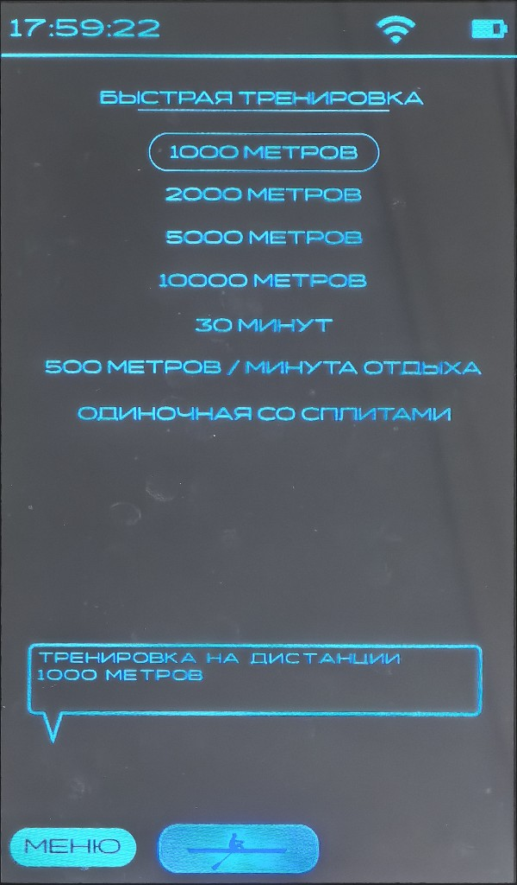

Выбранный пресет обведён рамкой, а в нижней части экрана выводится его краткое описание.

| Пресет | Цель | Особенности |
|---|---|---|
| **1000 МЕТРОВ** | Дистанция 1000 м | Счётчик дистанции на экране тренировки ведёт обратный отсчёт до нуля |
| **2000 МЕТРОВ** | Дистанция 2000 м | То же; по окончании дополнительно рассчитывается коэффициент Km (приложение В) |
| **5000 МЕТРОВ** | Дистанция 5000 м | |
| **10000 МЕТРОВ** | Дистанция 10 000 м | |
| **30 МИНУТ** | Время 30 мин | Время идёт вперёд; тренировка завершится через 30 минут от первого гребка |
| **500 МЕТРОВ / МИНУТА ОТДЫХА** | 5 интервалов по 500 м | Между интервалами 1 минута отдыха (после последнего интервала отдыха нет) |
| **ОДИНОЧНАЯ СО СПЛИТАМИ** | Настраиваемая цель | Одна цель (время или дистанция), разбитая на равные сплиты; можно включить лидера |

Порядок действий:

1. Нажмите нужный пресет.
2. Для режима **ОДИНОЧНАЯ СО СПЛИТАМИ** при необходимости нажмите **ИЗМЕНИТЬ** и задайте параметры (п. 6.1).
3. Нажмите синюю кнопку с гребцом внизу. Откроется экран тренировки.
4. Начните грести. Отсчёт пойдёт с первого гребка.

Кнопка **МЕНЮ** возвращает в главное меню.

### 6.1 Настройка одиночной тренировки со сплитами

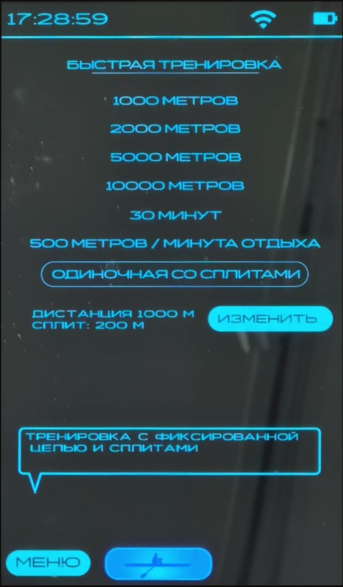

При выборе **ОДИНОЧНАЯ СО СПЛИТАМИ** под списком появляется сводка (по умолчанию «Дистанция 1000 м, Сплит: 200 м») и кнопка **ИЗМЕНИТЬ**. Она открывает окно настройки.

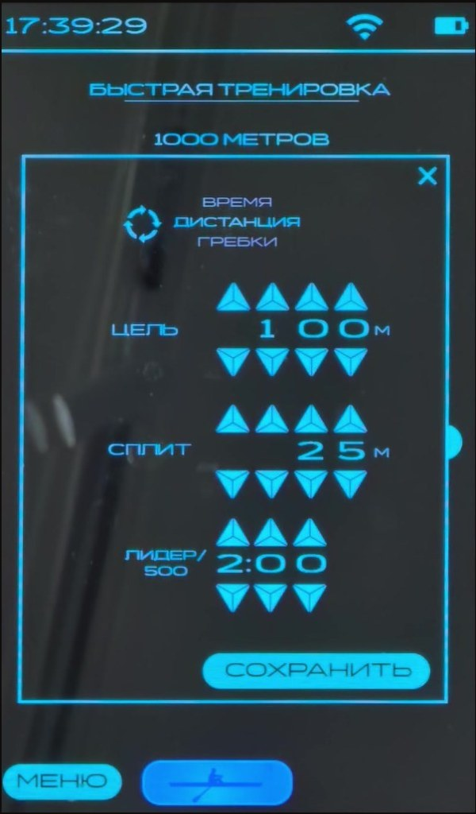

| Элемент | Назначение |
|---|---|
| Переключатель **ВРЕМЯ / ДИСТАНЦИЯ** | Чем ограничена тренировка. При переключении подставляются типовые значения: 30 мин / сплит 5 мин или 1000 м / сплит 200 м |
| **ЦЕЛЬ** | Общая дистанция (м) или время (мин). Диапазон 1…9999 |
| **СПЛИТ** | Длина отрезка, по которому фиксируются промежуточные результаты. Сплит не может быть больше цели; если цель уменьшить ниже сплита, сплит уменьшится автоматически |
| **ЛИДЕР/500** | Выключатель виртуального соперника. Включите и задайте его темп в формате мин:сек на 500 м (по умолчанию 2:00). Во время тренировки внизу экрана появится дорожка с двумя лодками |
| **СОХРАНИТЬ** | Применить настройки и закрыть окно. **✕** закрывает окно без изменений |

После сохранения сводка под списком обновится, например: «Дистанция 100 м, Сплит: 25 м, Темп лидера: 02:00 / 500м». Затем нажмите кнопку с гребцом.

ℹ Во время тренировки со сплитами в истории будет сохранён отдельный интервал на каждый сплит (например, 25, 50, 75 и 100 м), а средние показатели на экране считаются по всей тренировке, а не по текущему сплиту.

---

## 7. Экран тренировки

Экран тренировки открывается при запуске любой тренировки и при самостоятельном начале гребли из главного меню. Ниже показан экран с включённой панелью статистики. Номера на рисунке соответствуют таблице.

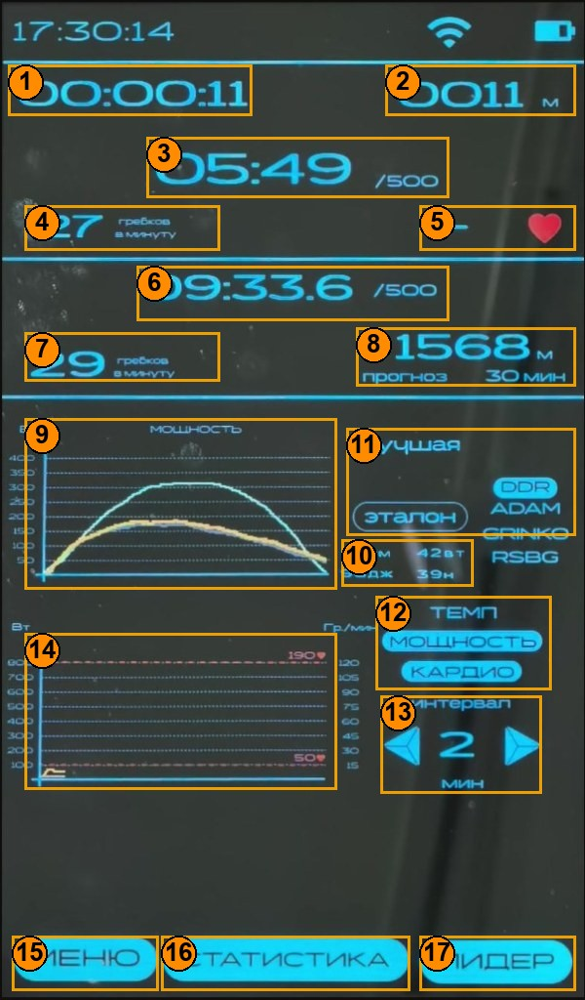

| № | Зона | Что показывает |
|---|---|---|
| 1 | Время тренировки | Время от первого гребка, чч:мм:сс. В тренировках со временем в качестве цели идёт вперёд до достижения цели. Отдых между интервалами входит в общее время |
| 2 | Дистанция | Для целей по дистанции — остаток до цели (обратный отсчёт); для остальных — пройденные метры текущего интервала |
| 3 | Текущий темп | Мгновенное время на 500 м, рассчитанное по текущей скорости лодки. Обновляется с каждым гребком |
| 4 | Гребков в минуту | Мгновенная частота гребли |
| 5 | Пульс | Текущий пульс с подключённого пульсометра; «--», если пульсометр не подключён |
| 6 | Средний темп | Среднее время на 500 м за текущий интервал (для тренировок со сплитами — за всю тренировку). Лодка «идёт по инерции»: пока вы не гребёте, время идёт, и средний темп ухудшается |
| 7 | Средняя частота | Средняя частота гребли за интервал, гр/мин |
| 8 | Прогноз | Сколько метров будет пройдено за 30 минут при текущем среднем темпе |
| 9 | График мощности гребка | Кривая мощности по ходу гребка. **Жёлтая** — последний гребок, **серая** — предыдущий, **светлая** — эталон или лучший гребок (п. 7.1) |
| 10 | Показатели последнего гребка | Длина гребка (см), средняя мощность (Вт), работа (Дж), средняя сила (Н) |
| 11 | **ЛУЧШАЯ / ЭТАЛОН** и список эталонов | Выбор кривой сравнения: лучший гребок тренировки или один из эталонов **DDR**, **ADAM**, **GRINKO**, **RSBG** |
| 12 | **ТЕМП / МОЩНОСТЬ / КАРДИО** | Включение линий нижнего графика: частота гребли (гр/мин), мощность (Вт), пульс (уд/мин) |
| 13 | **интервал ◀ 2 ▶ мин** | Ширина окна нижнего графика по времени: 1, 2, 3, 4, 5, 10, 15, 20 или 25 минут |
| 14 | Нижний график | История показателей тренировки, точка каждые 2 секунды. Красные пунктиры — границы пульса 50 и 190 |
| 15 | **МЕНЮ** | Выход из тренировки (с подтверждением) |
| 16 | **СТАТИСТИКА** | Показать или скрыть графики (зоны 9–14). Экран без графиков удобен для тренировок без анализа техники |
| 17 | **ЛИДЕР** | Показать или скрыть дорожку с лодками (только если в интервале задан лидер) |

### 7.1 Сравнение техники гребка

При включённой статистике верхний график накладывает кривую вашего гребка на кривую сравнения:

- **ЭТАЛОН** — одна из четырёх заложенных в панель эталонных кривых. Выберите нужную в списке справа: **DDR**, **ADAM**, **GRINKO** или **RSBG**.
- **ЛУЧШАЯ** — лучший по работе (Дж) гребок текущей тренировки. Обновляется автоматически, как только вы делаете более мощный гребок.

Меняя технику, старайтесь, чтобы форма жёлтой кривой приближалась к кривой сравнения. Вертикальная шкала мощности (400, 800, 1600 или 3200 Вт) подбирается автоматически под самый мощный гребок.

### 7.2 Лидер (виртуальный соперник)

Если в тренировке задан темп лидера, внизу экрана появляется дорожка с двумя лодками. Лодка лидера движется с заданным темпом с момента вашего первого гребка; вторая лодка — ваша. Подпись справа (например, «350 м») показывает дистанцию у правого края дорожки; по мере продвижения дорожка смещается. Кнопка **ЛИДЕР** скрывает и показывает дорожку.

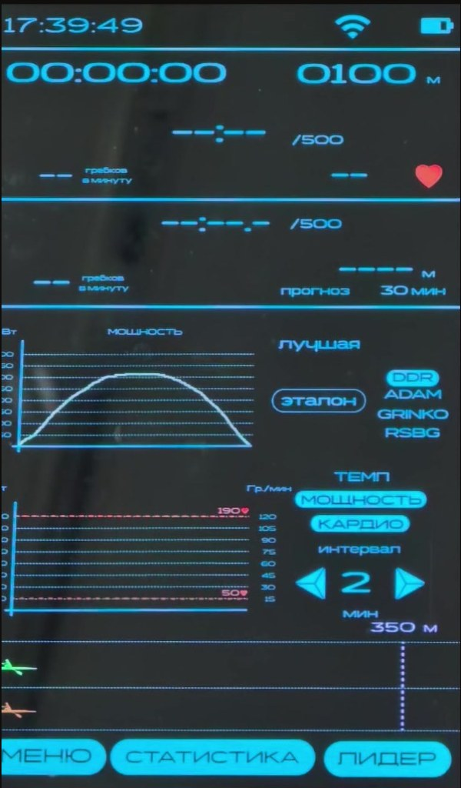

### 7.3 Указатель темпа

Если в интервале программы задан желаемый темп (гребков в минуту), на экране появляется стрелка-подсказка: «быстрее», если вы гребёте реже заданного более чем на 3 гр/мин, «медленнее», если чаще, и нейтральный значок при попадании в диапазон ±3 гр/мин.

### 7.4 Отдых между интервалами

Когда интервал с заданным отдыхом завершён, экран переключается в режим **ОТДЫХ** с обратным отсчётом времени отдыха. За три секунды до конца отдыха панель подаёт короткие сигналы, а по окончании — длинный сигнал и начинает следующий интервал. Показатели завершённого интервала остаются на экране до первого гребка нового интервала.

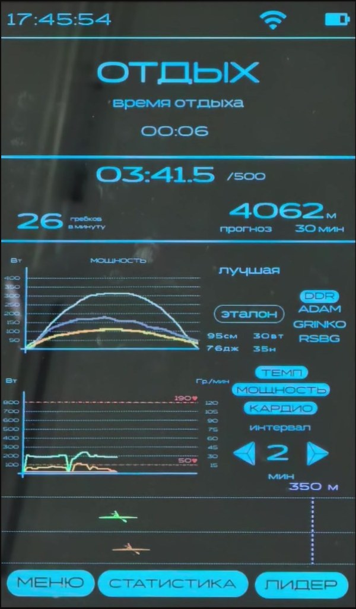

### 7.5 Финиш

После достижения последней цели экран показывает **ФИНИШ**: общее время, общую дистанцию, средний темп на 500 м, среднюю частоту гребли и прогноз на 30 минут. Тренировка сохраняется в истории. Для тренировок из четырёх отрезков по 500 м (например, 2000 м) дополнительно выводится коэффициент **Km** (приложение В).

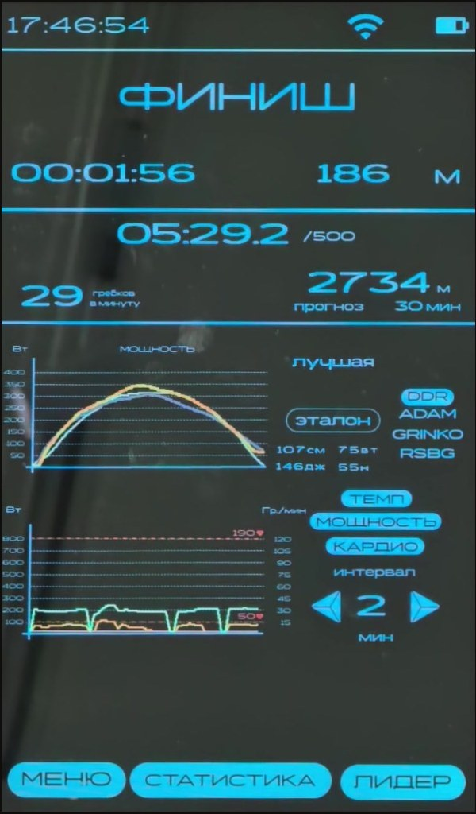

Чтобы вернуться в главное меню, нажмите **МЕНЮ** и подтвердите выход.

### 7.6 Выход из тренировки

Кнопка **МЕНЮ** открывает окно «ВЫЙТИ ИЗ ТРЕНИРОВКИ?».

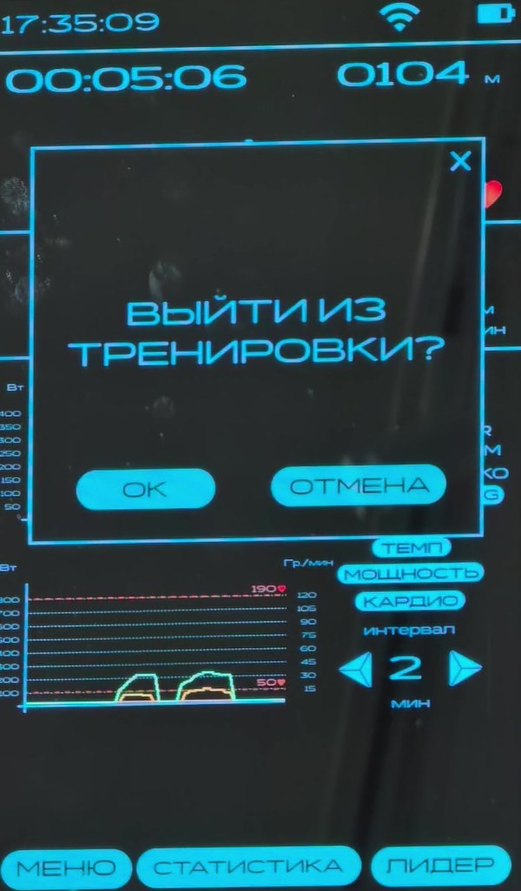

- **OK** — выйти в главное меню. Незавершённая тренировка длительностью более 30 секунд будет сохранена в истории с пометкой «Не завершена!».
- **ОТМЕНА** или **✕** — продолжить тренировку.

⚠ Во время заезда, управляемого внешней программой, выход кнопкой **МЕНЮ** заблокирован: заезд останавливает оператор.

---

## 8. Тренировка с программой

**Главное меню → ТРЕНИРОВКА С ПРОГРАММОЙ**

Редактор позволяет составить тренировку из нескольких интервалов с разными целями, отдыхом, лидером и желаемым темпом и сохранить её в одном из 99 слотов памяти.

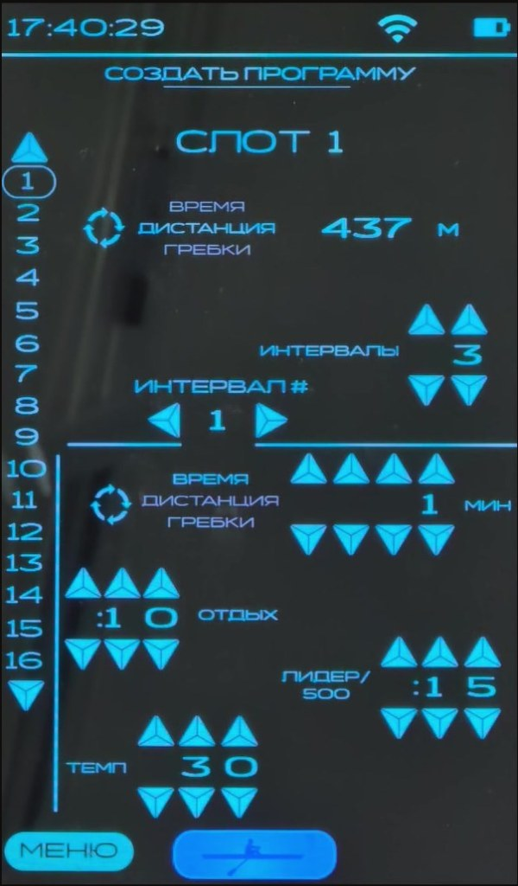

### 8.1 Элементы редактора

| Элемент | Назначение |
|---|---|
| Список слотов **1…16** слева, стрелки ▲ ▼ | Выбор слота программы (всего 99). Текущий слот обведён и подписан вверху («СЛОТ 1»). При переходе на другой слот текущая программа сохраняется автоматически |
| Переключатель **ВРЕМЯ / ДИСТАНЦИЯ / ГРЕБКИ** (верхний) и число справа | Оценка всей программы в выбранных единицах: сколько примерно метров, минут или гребков она займёт. Оценка пересчитывается из средних показателей (2:00 на 500 м, 30 гребков на 500 м) и носит справочный характер |
| **ИНТЕРВАЛЫ ▲ ▼** | Количество интервалов в программе (1…99). При увеличении новые интервалы копируют параметры текущего |
| **ИНТЕРВАЛ # ◀ ▶** | Номер редактируемого интервала |
| Переключатель **ВРЕМЯ / ДИСТАНЦИЯ / ГРЕБКИ** (нижний) и значение | Цель интервала: минуты (1…9999), метры (1…9999) или гребки (1…9999) |
| **ОТДЫХ** мин:сек | Пауза после интервала. У последнего интервала отдыха нет, поле скрыто |
| **ЛИДЕР/500** | Темп виртуального соперника на этом интервале, мин:сек на 500 м. Включается нажатием на подпись |
| **ТЕМП** | Желаемая частота гребли, гр/мин (10…999). Включается нажатием на подпись. Во время интервала на экране будет стрелка-подсказка (п. 7.3) |
| **МЕНЮ** | Сохранить программу и вернуться в главное меню |
| Кнопка с гребцом | Сохранить программу и запустить её |

### 8.2 Порядок составления программы

1. Выберите слот в списке слева.
2. Стрелками **ИНТЕРВАЛЫ** задайте количество интервалов.
3. Для каждого интервала (переключайтесь кнопками **◀ ▶** у **ИНТЕРВАЛ #**):
   1. выберите тип цели переключателем и задайте значение стрелками;
   2. задайте время отдыха после интервала;
   3. при необходимости включите **ЛИДЕР/500** и задайте его темп;
   4. при необходимости включите **ТЕМП** и задайте желаемую частоту гребли.
4. Проверьте оценку общей длительности вверху.
5. Нажмите кнопку с гребцом. Откроется экран тренировки; отсчёт начнётся с первого гребка.

Пример из видеообзора: интервал 1 — 1 минута, отдых 10 с, лидер 1:15, темп 30; интервал 2 — 20 метров, отдых 10 с; интервал 3 — 10 гребков. На экране тренировки после каждого интервала показывается отдых, а после третьего — **ФИНИШ** с итогами.

ℹ Программы хранятся в энергонезависимой памяти и сохраняются при выключении питания.

---

## 9. Заезд (соревновательный режим)

**Главное меню → ЗАЕЗД**

Режим предназначен для одновременных заездов на нескольких тренажёрах под управлением внешней программы оператора. Программа задаёт дистанцию, список участников и даёт общий старт; панель каждого тренажёра показывает ход заезда и передаёт результаты.

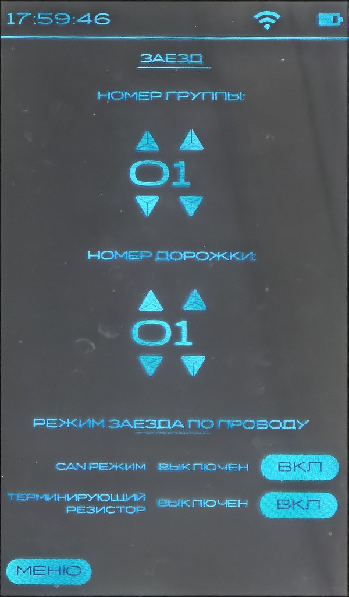

| Элемент | Назначение |
|---|---|
| **НОМЕР ГРУППЫ ▲ ▼** | Номер группы (01…99), к которой относится тренажёр |
| **НОМЕР ДОРОЖКИ ▲ ▼** | Номер дорожки (01…99). По нему программа оператора привязывает результат к конкретному участнику |
| **РЕЖИМ ЗАЕЗДА ПО ПРОВОДУ: CAN РЕЖИМ** | Включение проводного режима по шине CAN, когда Wi‑Fi недоступен. Кнопка **ВКЛ/ВЫКЛ** переключает режим, состояние выводится рядом |
| **ТЕРМИНИРУЮЩИЙ РЕЗИСТОР** | Включите на двух крайних устройствах шины CAN |
| **МЕНЮ** | Возврат в главное меню. Номера группы и дорожки сохраняются сразу |

### 9.1 Подготовка к заезду

1. Подключите все панели к одной Wi‑Fi‑сети (раздел 12.1) **или** соедините их кабелем CAN и включите **CAN РЕЖИМ** на каждой панели (терминирующий резистор — на первой и последней).
2. На каждой панели задайте номер группы и номер дорожки.
3. Убедитесь, что значок Wi‑Fi в строке состояния стал **зелёным** — панель найдена программой оператора.

⚠ Режимы Wi‑Fi и CAN взаимоисключающие: при включении CAN панель отключается от Wi‑Fi.

### 9.2 Ход заезда

1. Оператор «закрепляет» заезд: на панели открывается экран подготовки с фамилией участника и номером дорожки. Выйти из него с панели нельзя.
2. По команде оператора начинается отсчёт **3 – 2 – 1**, затем старт. В отличие от обычной тренировки, время заезда идёт от момента общего старта, а не от первого гребка.
3. На экране заезда показываются текущие показатели и положение лодок участников относительно дистанции.
4. После финиша или остановки заезда оператором панель показывает экран остановки и возвращается в главное меню, когда оператор снимает блокировку. Результат сохраняется в истории с пометкой «Гонка».

---

## 10. История тренировок

**Главное меню → ИСТОРИЯ ТРЕНИРОВОК**

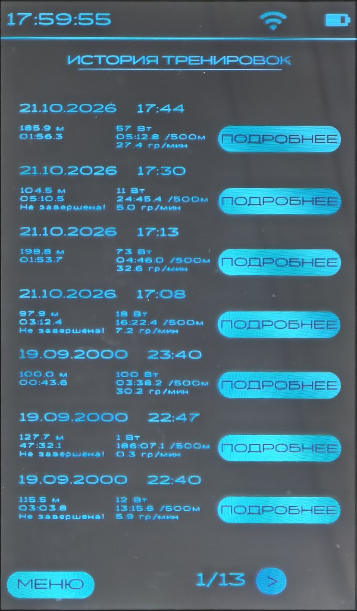

Список отсортирован от новых к старым, по 7 записей на странице. Для каждой записи:

| Поле | Значение |
|---|---|
| Дата и время | Начало тренировки |
| Левый столбец | Дистанция (м), длительность (мм:сс.д), пометки **«Не завершена!»** (прервана до цели) и **«Гонка»** (заезд) |
| Правый столбец | Средняя мощность (Вт), средний темп (мин:сек /500м), средняя частота (гр/мин) |
| **ПОДРОБНЕЕ** | Открыть информацию о тренировке |

Внизу: **МЕНЮ** — в главное меню, `1/13` — номер страницы, **<** **>** — листание.

ℹ Дата «19.09.2000» у старых записей означает, что в момент тренировки часы панели не были установлены.

### 10.1 Информация о тренировке

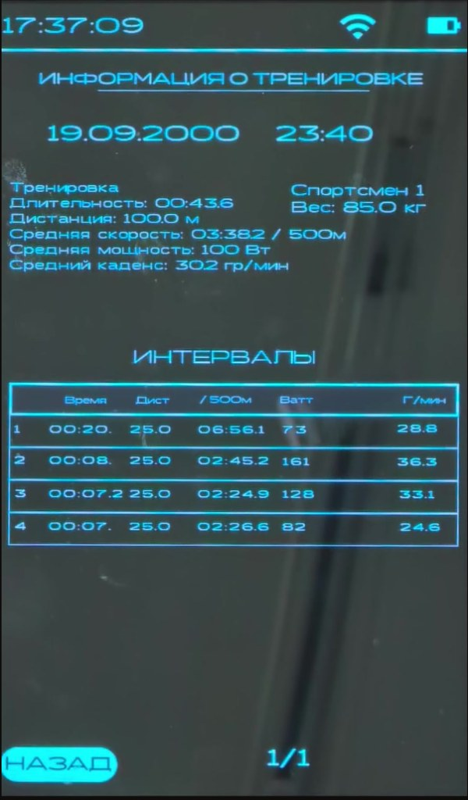

Сверху — дата, тип (Тренировка / Гонка), длительность, дистанция, средняя скорость (на 500 м), средняя мощность, средний каденс, номер профиля спортсмена и его вес. Пометка «(не завершено)» — тренировка прервана.

Таблица **ИНТЕРВАЛЫ** содержит по строке на каждый интервал или сплит:

| Столбец | Значение |
|---|---|
| № | Номер интервала |
| Время | Длительность интервала, мм:сс.д |
| Дист | Пройденная дистанция, м |
| /500м | Средний темп на 500 м |
| Ватт | Средняя мощность |
| Г/мин | Средняя частота гребли |

По 9 интервалов на странице; листание стрелками внизу. **НАЗАД** возвращает в список.

---

## 11. Спортсмен

**Главное меню → СПОРТСМЕН**

Панель хранит шесть профилей. Текущий профиль используется для расчётов (вес влияет на оценку калорий и коэффициент Km) и записывается в историю вместе с тренировкой.

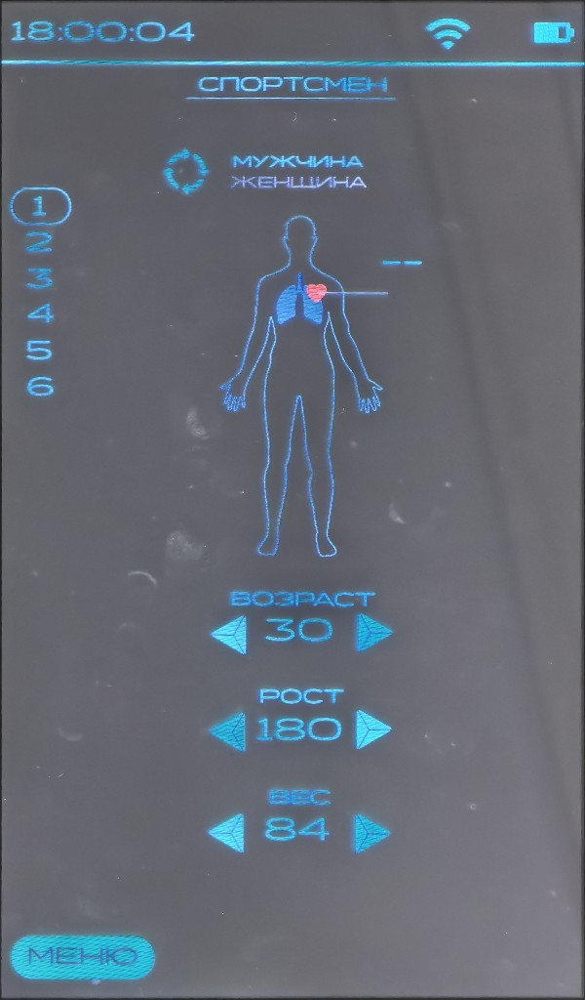

| Элемент | Назначение |
|---|---|
| Список **1…6** слева | Выбор профиля. Выбранный обведён. При выборе другого профиля предыдущий сохраняется |
| Значок-переключатель **МУЖЧИНА / ЖЕНЩИНА** | Пол |
| Число у сердца | Текущий пульс с подключённого пульсометра («--», если нет) |
| **ВОЗРАСТ ◀ ▶** | Возраст, лет |
| **РОСТ ◀ ▶** | Рост, см |
| **ВЕС ◀ ▶** | Вес, кг |
| **МЕНЮ** | Сохранить и вернуться |

Выбранный профиль остаётся активным до следующего изменения, в том числе после выключения панели.

---

## 12. Подключения: Wi‑Fi и пульсометр

**Главное меню → ПОДКЛЮЧЕНИЯ**

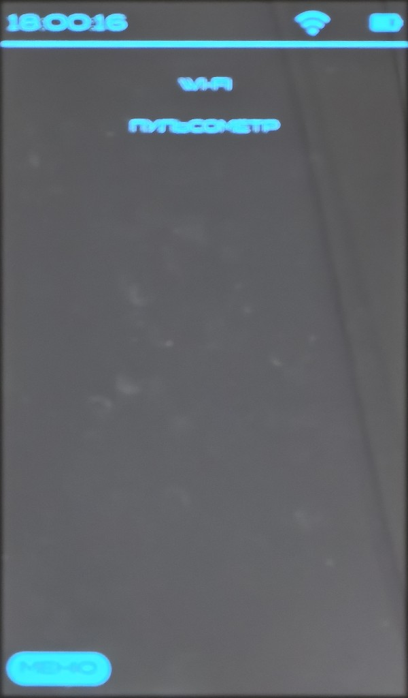

Экран содержит два пункта: **WI‑FI** и **ПУЛЬСОМЕТР**.

### 12.1 Wi‑Fi

Wi‑Fi нужен для заездов, для связи с управляющей программой и для автоматического обновления прошивки. Панель помнит одну сеть и подключается к ней автоматически после включения.

**Если панель не подключена**, пункт **WI‑FI** открывает список найденных сетей.

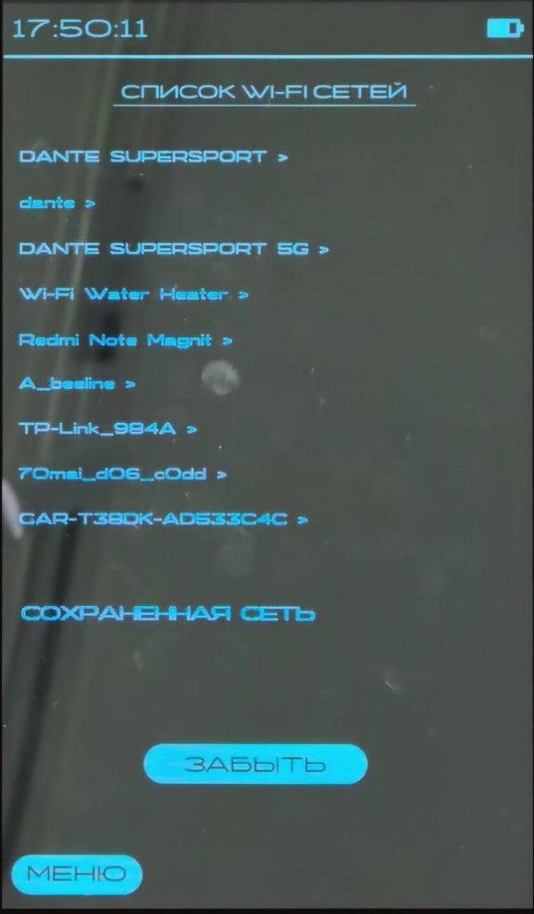

- В списке до 9 сетей, список обновляется автоматически. Сохранённая сеть помечена «(saved)».
- Нажмите на название сети. Открытая сеть подключится сразу; для защищённой откроется ввод пароля.
- Внизу — название **СОХРАНЕННОЙ СЕТИ** и кнопка **ЗАБЫТЬ**, удаляющая сохранённые данные.

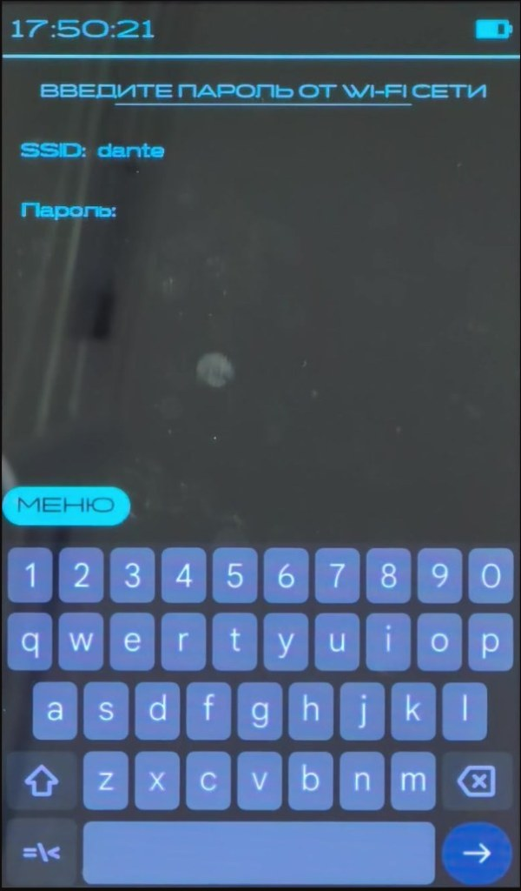

Ввод пароля:

| Клавиша | Действие |
|---|---|
| Буквы и цифры | Ввод символа (до 20 символов) |
| ⇧ | Переключение на заглавные буквы |
| **=\\<** | Открыть дополнительную раскладку со знаками |
| ⌫ | Удалить последний символ |
| → (синяя) | Подтвердить и подключиться |
| **МЕНЮ** | Вернуться к списку сетей |

⚠ Пароль должен содержать не менее 8 символов (требование WPA2). При более коротком пароле кнопка подтверждения не сработает.

После подтверждения откроется экран состояния: «Подключение к "имя сети"…», затем «Подключено к "имя сети"» и IP‑адрес панели.

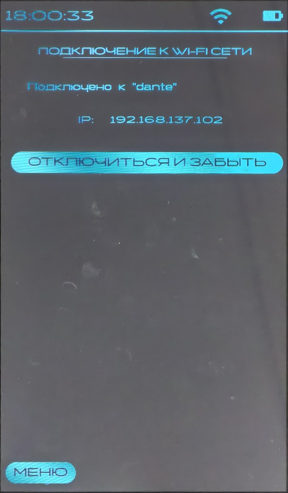

**Если панель уже подключена**, пункт **WI‑FI** открывает именно этот экран. Кнопка **ОТКЛЮЧИТЬСЯ И ЗАБЫТЬ** разрывает соединение, удаляет сохранённую сеть и возвращает к списку сетей.

### 12.2 Пульсометр

Пункт **ПУЛЬСОМЕТР** открывает экран **ПОДКЛЮЧЕНИЕ ПУЛЬСОМЕТРА**.

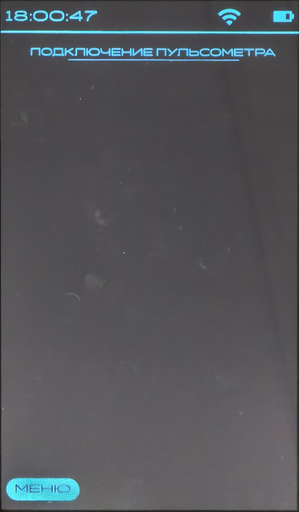

1. Наденьте и активируйте Bluetooth‑пульсометр (нагрудный датчик или браслет с передачей пульса по стандартному профилю Heart Rate).
2. Панель сканирует эфир, пока открыт этот экран, и показывает найденные устройства (до 6) с кнопкой **Connect**.
3. Нажмите **Connect** у нужного устройства. Во время подключения выводится «Connecting…».
4. После подключения в списке остаётся только подключённое устройство с кнопкой **Disconnect**, а в строке состояния появляется значок Bluetooth.

Пульс отображается на экране тренировки (зона 5) и на экране «Спортсмен», а при включённой линии **КАРДИО** — на нижнем графике. Для отключения нажмите **Disconnect**.

---

## 13. Опции и настройки

**Главное меню → ОПЦИИ И НАСТРОЙКИ**

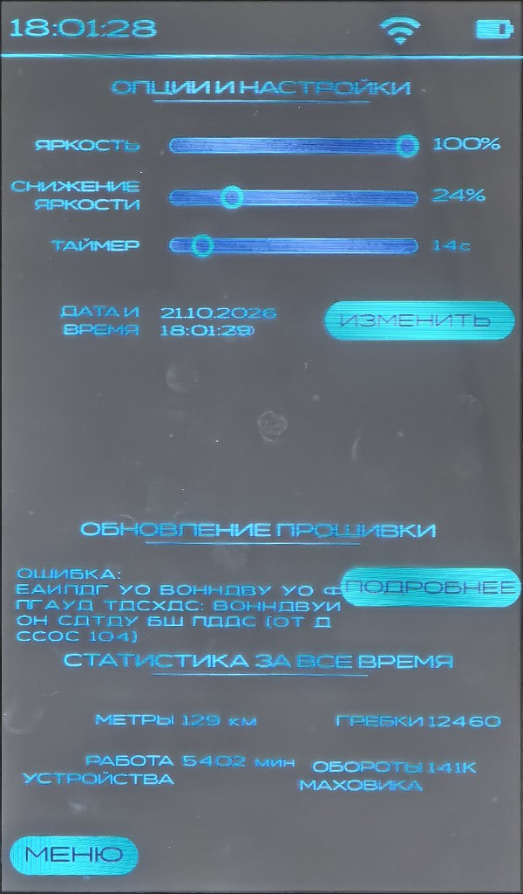

### 13.1 Яркость

| Параметр | Значение |
|---|---|
| **ЯРКОСТЬ** | Рабочая яркость подсветки, 1…100 % |
| **СНИЖЕНИЕ ЯРКОСТИ** | Яркость в режиме простоя в процентах от рабочей. Значение 0 % полностью гасит подсветку для экономии заряда |
| **ТАЙМЕР** | Время бездействия в секундах, после которого яркость снижается. 0 — снижение выключено (на экране «Выкл») |

Переместите ползунок; значение сохраняется автоматически. Касание экрана возвращает рабочую яркость.

### 13.2 Дата и время

Текущие дата и время показаны рядом с кнопкой **ИЗМЕНИТЬ**. Кнопка открывает окно **УСТАНОВКА ВРЕМЕНИ**.

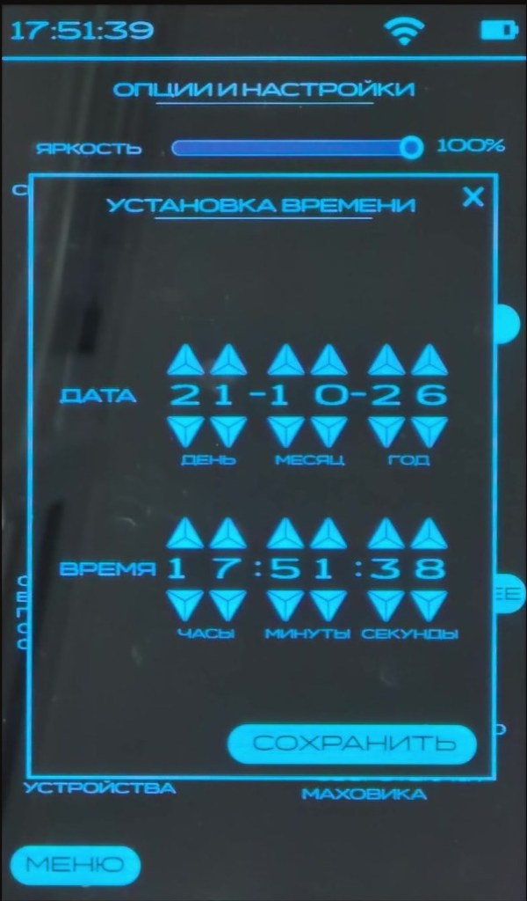

Задайте стрелками ▲ ▼ день, месяц, год (две последние цифры), часы, минуты и секунды и нажмите **СОХРАНИТЬ**. Количество дней в месяце проверяется автоматически. **✕** закрывает окно без изменений.

Часы идут автономно от встроенной батареи часов, поэтому время не сбрасывается при выключении панели.

### 13.3 Обновление прошивки

Блок показывает состояние проверки обновлений (например, «Новых обновлений не найдено» или «Доступно обновление прошивки! Новая версия: …»). Кнопка **ПОДРОБНЕЕ** открывает страницу с описанием обновления и кнопкой запуска. Подробно — в разделе 14.

### 13.4 Статистика за всё время

| Показатель | Значение |
|---|---|
| **МЕТРЫ** | Суммарная дистанция за весь срок службы, км |
| **ГРЕБКИ** | Общее количество гребков |
| **РАБОТА УСТРОЙСТВА** | Суммарное время работы, мин |
| **ОБОРОТЫ МАХОВИКА** | Общее число оборотов маховика |

Статистика обновляется каждые 10 секунд и не сбрасывается.

---

## 14. Обновление прошивки

Панель обновляет два компонента: прошивку вычислительного модуля и графический интерфейс дисплея. Проверка выполняется автоматически при каждом открытии экрана **ОПЦИИ И НАСТРОЙКИ**, если панель подключена к Wi‑Fi с доступом в интернет.

Порядок обновления:

1. Подключите панель к Wi‑Fi (раздел 12.1) и подключите зарядное устройство.
2. Откройте **Главное меню → ОПЦИИ И НАСТРОЙКИ**. Дождитесь результата проверки в блоке **ОБНОВЛЕНИЕ ПРОШИВКИ**.
3. Если доступно обновление, нажмите **ПОДРОБНЕЕ**. На странице показаны текущая и новая версии, время сборки и список изменений.
4. Нажмите кнопку обновления. Загрузка и установка идут автоматически; ход показывается в процентах.
5. После установки панель перезагрузится сама.

Состояния, которые выводятся в блоке обновления:

| Сообщение | Значение |
|---|---|
| Ожидание подключения к сети wi‑fi… | Нет Wi‑Fi. Подключитесь к сети |
| Поиск локального сервера обновлений… / Подключение к серверу обновлений… | Идёт поиск сервера |
| Проверка доступных обновлений… | Запрос версий |
| Новых обновлений не найдено | Установлена последняя версия |
| Доступно обновление прошивки! / дисплея! | Нажмите **ПОДРОБНЕЕ**, затем кнопку обновления |
| Скачивание обновления прошивки… N % | Загрузка |
| Скачивание файлов дисплея… N % | Загрузка файлов интерфейса |
| Обновление дисплея… Дождитесь перезагрузки устройства | Запись интерфейса в дисплей |
| Обновление завершено! | Перезагрузка |
| Ошибка: … | Ошибка проверки или установки. Проверьте сеть и повторите |

⚠ Обновление интерфейса дисплея занимает несколько минут. В это время экран не реагирует на касания. Не выключайте питание и не отключайте зарядное устройство до автоматической перезагрузки.

ℹ Пока идёт обновление, кнопка **МЕНЮ** на экране настроек не действует.

---

## 15. Возможные проблемы и их решение

| Признак | Причина | Что сделать |
|---|---|---|
| После нажатия кнопки запуска экран тренировки показывает нули | Это нормально: отсчёт начинается с первого гребка | Начните грести |
| Тренировка не начинается из главного меню при гребле | Ручка потянута слишком слабо, панель не распознала гребок | Сделайте несколько полных гребков в нормальном темпе |
| В истории запись помечена «Не завершена!» | Тренировка прервана кнопкой **МЕНЮ** или не имела цели (свободная гребля) | Для «завершённых» записей запускайте тренировку с целью и доводите до **ФИНИШ** |
| Тренировка короче 30 секунд не попала в историю | Короткие незавершённые тренировки не сохраняются | — |
| В строке состояния нет значка Wi‑Fi | Нет подключения | **Подключения → WI‑FI**, выберите сеть и введите пароль |
| Кнопка подтверждения пароля не срабатывает | Пароль короче 8 символов | Введите пароль полностью |
| Значок Wi‑Fi синий, а не зелёный, заезд не начинается | Панель не найдена программой оператора | Убедитесь, что панель и компьютер оператора в одной сети; проверьте номер группы и дорожки |
| Пульсометр не найден | Датчик не активен или не поддерживает стандартный профиль Bluetooth Heart Rate | Намочите электроды нагрудного датчика, включите передачу пульса на браслете, оставайтесь на экране **ПОДКЛЮЧЕНИЕ ПУЛЬСОМЕТРА** |
| Пульс показывает «--» | Пульсометр отключился | Подключите заново через **Подключения → ПУЛЬСОМЕТР** |
| Неверная дата в истории («19.09.2000»), в настройках «Не установлено!» | Часы не установлены | **Опции и настройки → ИЗМЕНИТЬ**, задайте дату и время |
| Экран гаснет во время тренировки | Низкое значение **СНИЖЕНИЕ ЯРКОСТИ** и короткий **ТАЙМЕР** | Увеличьте значения или задайте таймер 0 |
| Обновление заканчивается ошибкой | Нет интернета или сервер недоступен | Проверьте сеть, повторите позже |
| Экран не реагирует несколько минут после запуска обновления | Идёт запись интерфейса дисплея | Дождитесь автоматической перезагрузки, не выключайте питание |
| Сообщение об ошибке датчиков или питания в сервисном окне диагностики | Неисправность датчика, модуля батареи, часов или памяти | Обратитесь в сервис, сообщите текст ошибки и версию прошивки |

Если панель зависла, выключите и включите питание переключателем на корпусе. Настройки, программы и история сохраняются.

---

## 16. Уход, питание и безопасность

- Заряжайте панель от комплектного адаптера USB Type‑C. Значок зарядки в строке состояния показывает, что заряд идёт. При подключённом адаптере панель питается от него и автоматически переходит на аккумулятор при его отключении.
- Следите за значком батареи: при критическом уровне (до 10 %) подключите зарядное устройство.
- Управляйте экраном пальцем. Не используйте острые предметы.
- Протирайте экран мягкой слегка влажной салфеткой при выключенной панели. Не допускайте попадания жидкости внутрь корпуса.
- Рабочая температура от +10 до +50 °C, влажность до 80 %.
- Не разбирайте панель. Обновляйте прошивку только штатным способом (раздел 14).
- Общие требования безопасности при занятиях на тренажёре приведены в руководстве по эксплуатации тренажёра.

---

## 17. Приложения

### Приложение А. Назначение экранов и кнопок

| Экран | Кнопки и элементы | Переходы |
|---|---|---|
| Главное меню | 7 пунктов | Во все разделы; гребля открывает экран тренировки |
| Быстрая тренировка | Пресеты, **ИЗМЕНИТЬ**, **МЕНЮ**, кнопка с гребцом | Окно сплитов; экран тренировки; главное меню |
| Окно «Цель / Сплит / Лидер» | Переключатель ВРЕМЯ/ДИСТАНЦИЯ, стрелки, **ЛИДЕР/500**, **СОХРАНИТЬ**, **✕** | Быстрая тренировка |
| Экран тренировки | **МЕНЮ**, **СТАТИСТИКА**, **ЛИДЕР**, ЛУЧШАЯ/ЭТАЛОН, DDR/ADAM/GRINKO/RSBG, ТЕМП/МОЩНОСТЬ/КАРДИО, интервал ◀ ▶ | Окно выхода; главное меню |
| Окно «Выйти из тренировки?» | **OK**, **ОТМЕНА**, **✕** | Главное меню; экран тренировки |
| Создать программу | Слоты, ИНТЕРВАЛЫ, ИНТЕРВАЛ #, цель, ОТДЫХ, ЛИДЕР/500, ТЕМП, **МЕНЮ**, кнопка с гребцом | Экран тренировки; главное меню |
| Заезд | НОМЕР ГРУППЫ, НОМЕР ДОРОЖКИ, CAN РЕЖИМ, ТЕРМИНИРУЮЩИЙ РЕЗИСТОР, **МЕНЮ** | Главное меню; подготовка к заезду (по команде оператора) |
| История тренировок | **ПОДРОБНЕЕ** ×7, **<** **>**, **МЕНЮ** | Информация о тренировке; главное меню |
| Информация о тренировке | Таблица интервалов, **<** **>**, **НАЗАД** | История тренировок |
| Спортсмен | Слоты 1…6, пол, ВОЗРАСТ, РОСТ, ВЕС, **МЕНЮ** | Главное меню |
| Подключения | **WI‑FI**, **ПУЛЬСОМЕТР**, **МЕНЮ** | Список сетей или состояние подключения; пульсометр; главное меню |
| Список Wi‑Fi сетей | Сети, **ЗАБЫТЬ**, **МЕНЮ** | Ввод пароля; состояние подключения; главное меню |
| Ввод пароля | Клавиатура, ⇧, =\\<, ⌫, →, **МЕНЮ** | Состояние подключения; список сетей |
| Подключение к Wi‑Fi сети | **ОТКЛЮЧИТЬСЯ И ЗАБЫТЬ**, **МЕНЮ** | Список сетей; главное меню |
| Подключение пульсометра | Устройства с **Connect / Disconnect**, **МЕНЮ** | Главное меню |
| Опции и настройки | Ползунки яркости, **ИЗМЕНИТЬ**, **ПОДРОБНЕЕ**, **МЕНЮ** | Установка времени; обновление прошивки; главное меню |
| Установка времени | Стрелки, **СОХРАНИТЬ**, **✕** | Опции и настройки |

### Приложение Б. Термины

| Термин | Значение |
|---|---|
| Темп, /500 | Время прохождения 500 м при текущей скорости, мин:сек. Чем меньше, тем быстрее |
| Гр/мин, каденс | Частота гребли, гребков в минуту |
| Интервал | Часть тренировки с собственной целью (время, дистанция или гребки) и, возможно, отдыхом после неё |
| Сплит | Равный отрезок одной цели, по которому фиксируются промежуточные результаты |
| Лидер | Виртуальный соперник, движущийся с заданным темпом |
| Эталон | Заложенная в панель образцовая кривая мощности гребка (DDR, ADAM, GRINKO, RSBG) |
| Мощность гребка | Средняя мощность за гребок, Вт; работа — энергия гребка, Дж; сила — средняя сила на рукоятке, Н |
| Прогноз 30 мин | Дистанция, которая будет пройдена за 30 минут при текущем среднем темпе |

### Приложение В. Коэффициент Km

Для тренировок, состоящих из четырёх отрезков по 500 м (например, пресет **2000 МЕТРОВ**), на экране **ФИНИШ** выводится значение Km. Это лучшая из средних мощностей на отрезках 500 м, отнесённая к массе спортсмена в степени ⅔ (масса берётся из активного профиля спортсмена). Показатель позволяет сравнивать спортсменов разного веса.

### Приложение Г. Технические ограничения текущей версии

- Цель «гребки» в окне быстрой тренировки со сплитами недоступна; она задаётся только в редакторе программ.
- В окне быстрой тренировки сплит по времени задаётся в минутах.
- Лист Wi‑Fi‑сетей показывает первые 9 найденных сетей.
- Список пульсометров показывает до 6 устройств.
